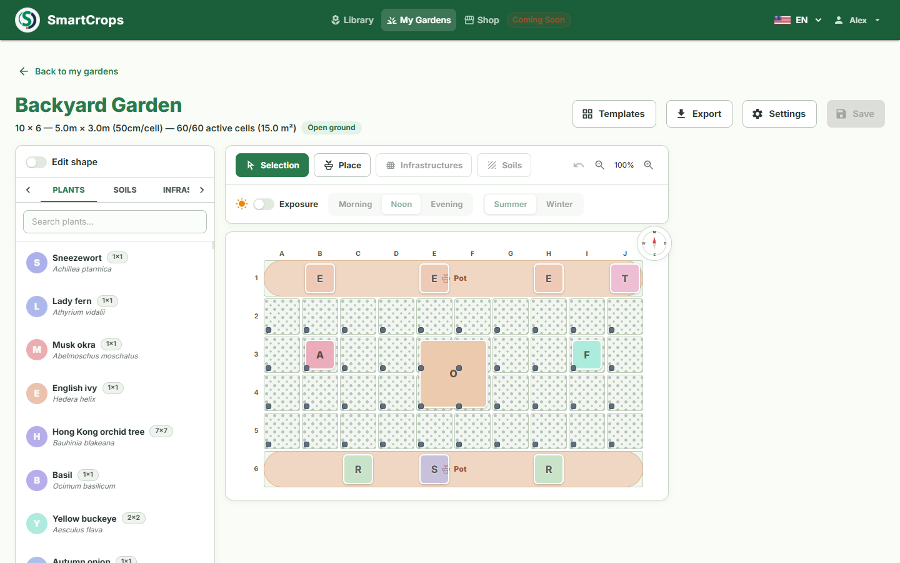
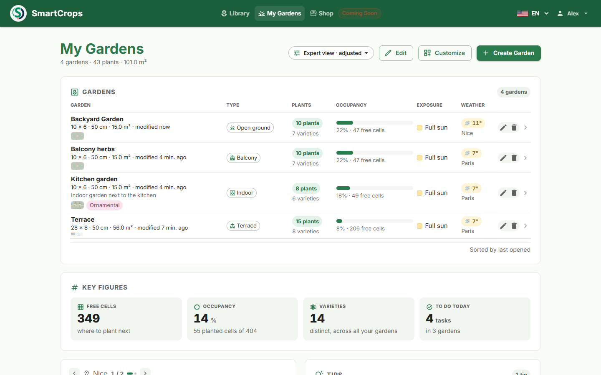
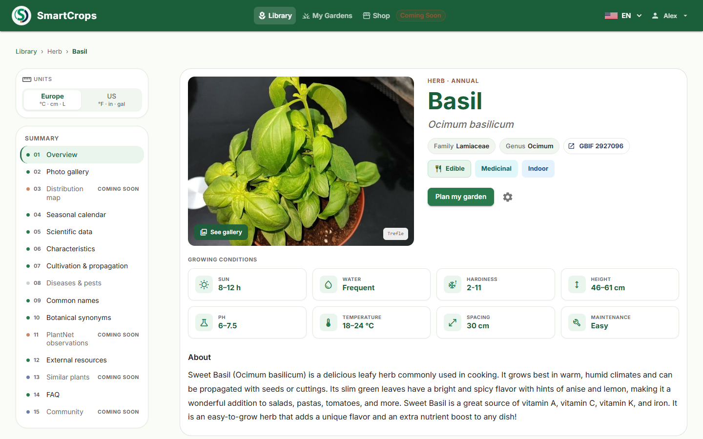

# SmartCrops

A web application for planning and following a real garden. Browse a bilingual plant
library, draw your garden on a grid that models sunlight and shade, and keep an eye on it
from a dashboard.

**Live: [smartcrops.fr](https://smartcrops.fr)** — the site opens in French; the language
menu is in the header.



| Gardens dashboard | Plant detail |
| --- | --- |
|  |  |

SmartCrops is a personal project: a ground-up rebuild of a 2022 Master's thesis prototype,
taken all the way to production.

---

## What is live today

Everything in this section is in production. What is not built yet is listed separately
under [Planned](#planned).

### Plant library and finder

- **More than 500 plants** with French and English common names, scientific names and
  growing data: sunlight, watering, hardiness, spacing, dimensions.
- **Faceted search** served by Typesense: a full-text query combined with category and
  enum facets (type, life cycle, watering, care level…), boolean filters, and range
  sliders for height, hardiness zone, pH, spacing and temperature. Facet counts follow the
  current selection.
- **A detail page per plant**: photo gallery, growing calendar, scientific data,
  characteristics, care data shown as gauges, pests.

### Garden planner

An interactive grid where a garden is designed cell by cell.

- **Garden configuration** — dimensions, cell size, orientation, garden type (balcony,
  terrace, open ground, greenhouse, indoor), hemisphere and latitude band.
- **Sunlight exposure model** — per-cell exposure computed from orientation, time of day
  and season, shown as a colour layer that can be toggled.
- **Infrastructures** — walls, fences, trellises, paths, water points and pots painted on
  the grid. Those that block light cast directional shadows that follow the selected time
  and season.
- **Plant placement** — click-to-place and drag & drop, with a ghost preview, snapping to
  the grid and collision feedback. A plant occupies a multi-cell footprint derived from its
  spacing data, which the user can resize.
- **Soil types** painted cell by cell, and **shape editing** to model non-rectangular
  gardens.
- **Garden templates** to start from, **export** of the plan as a PNG image or a
  print-ready A4 sheet, an unsaved-changes guard, and confirmation before deleting a
  garden or removing a plant.

### Gardens dashboard

- **A grid of widgets** — weather, gardens, tips, this month, to-do, counters, statistics
  and key figures — that each user can reorder, resize and hide. The layout is saved with
  the account.
- **Three formulas** — novice, gardener and expert — decide which widgets and sizes are
  offered. The server is the authority on what each formula allows.
- **Weather by location** — forecasts from WeatherAPI.com for a place set once on the
  profile and overridable per garden.

### Accounts and platform

- **Authentication** — registration with e-mail confirmation, password reset and Google
  sign-in, built on ASP.NET Core Identity. The session is a JWT carried in an HttpOnly
  cookie.
- **Account control** — profile, password change, export of personal data, and account
  deletion.
- **Administration** — an area gated by a server-side role, used to maintain the
  catalogue: import, enrichment, translations, search index.
- **French and English** across the interface, with a test that keeps the two locale files
  in parity; **light and dark themes**; layouts from phone to desktop.
- **Public pages** — home, about, a contact form backed by a real mail service, legal
  notice, privacy policy and terms of use.

---

## Planned

None of this is built. On the site, most of these carry a "Coming soon" badge.

- Monitoring a garden with connected sensors.
- An AI gardening assistant.
- A shop, a newsletter and in-app notifications.
- More finder filters (flower colour, habit, season, soil pH, light level), which wait for
  more complete data.
- A harvest widget on the dashboard.
- More interface languages.

---

## Tech stack

| Layer | Technology |
| --- | --- |
| Frontend | React 19, TypeScript, Vite, Material UI 7, react-i18next, dnd-kit |
| Backend | .NET 8, ASP.NET Core, Entity Framework Core 8 |
| Database | PostgreSQL 16 |
| Search | Typesense |
| Auth | ASP.NET Core Identity, JWT in an HttpOnly cookie, Google OAuth |
| E-mail | MailKit (SMTP) |
| Weather | WeatherAPI.com |
| Tests | xUnit, Testcontainers (PostgreSQL), Vitest, Testing Library, headless Chrome |
| Containers | Docker Compose; Traefik 3 and nginx in production |
| CI / CD | GitHub Actions, GitHub Container Registry |
| Code review | CodeRabbit |
| Dependencies | Dependabot |

### Plant data sources

Plant data is aggregated from three sources into a denormalised read model
([ADR-0003](docs/adr/0003-plant-aggregate-as-denormalized-read-model.md)). Each one is
credited on the site.

- **[GBIF](https://www.gbif.org/)** — taxonomy. Its taxon key is the deduplication key of
  the catalogue ([ADR-0004](docs/adr/0004-gbif-taxonkey-dedup-strategy.md)).
- **[Trefle](https://trefle.io/)** — photographs, common names, synonyms.
- **[Perenual](https://perenual.com/)** — care data, watering, dimensions, spacing.

---

## Architecture

```text
Browser --HTTPS--> Traefik --> web   static React build served by nginx
                           --> api   ASP.NET Core --> PostgreSQL
                                                  --> Typesense
```

- **One repository** holds the frontend (`src/frontend`), the backend (`src/backend`) and
  the deployment files.
- **The backend** is one solution of three projects plus tests: `SmartCrops.Api`
  (controllers, authentication, composition root), `SmartCrops.Core` (domain and
  contracts) and `SmartCrops.Infrastructure` (EF Core, search, e-mail, external APIs).
- **Production** runs five containers on a single server: Traefik, web, api, db and
  typesense. Traefik is the only one that publishes ports; it terminates TLS with a Let's
  Encrypt certificate, routes API requests to the API and everything else to the static
  site.
- **Development** runs four containers from `docker-compose.yml`: db, api, typesense and a
  web container that runs the Vite dev server. By default every port is bound to the
  loopback interface.
- **Decisions** that shaped the code are recorded as ADRs in [`docs/adr`](docs/adr).

---

## Quality and delivery

- **Tests** — 1,580 backend tests and 4,675 frontend tests, none skipped (commit
  `ae4e572`, November 2026). The backend suite includes integration tests against a real
  PostgreSQL started by Testcontainers. The frontend suite includes two layout suites that
  measure pages in a headless Chrome.
- **CI** on every push and pull request to `develop` and `main`
  ([`ci.yml`](.github/workflows/ci.yml)): format check, build and tests for the backend;
  lint, tests and build for the frontend.
- **Two branches, two roles** — `develop` integrates and `main` publishes. Merging to
  `develop` deploys nothing; publishing is a fast-forward push of `develop` onto `main`.
- **CD** ([`cd.yml`](.github/workflows/cd.yml)) starts once CI is green on `main`. It
  builds both images, tags them with the commit SHA and pushes them to the registry; the
  server pulls them and never builds. Before deploying, a guard reads the commit that
  production actually runs and lets the deployment through only if the candidate is that
  commit or descends from it. The deployment then takes a database dump, updates the API,
  waits for its health check, and updates the web container last.
- **Rollback** is a manual workflow ([`rollback.yml`](.github/workflows/rollback.yml)): it
  redeploys a chosen image tag and can restore a dump first. A failed deployment never
  rolls back on its own.
- **Review** — CodeRabbit reviews every pull request
  ([`.coderabbit.yaml`](.coderabbit.yaml)). Dependabot proposes dependency updates every
  week ([`dependabot.yml`](.github/dependabot.yml)).

---

## Run it locally

This repository is published for review. It is not a turnkey install: **a bare clone does
not start.**

The API refuses to boot without a few values that are deliberately absent from every
tracked file. They are supplied locally through a `docker-compose.override.yml`, which
Compose merges automatically and Git ignores. That file is not in this repository and has
no sample here.

| Value | Needed |
| --- | --- |
| Database password | Required |
| JWT signing key (at least 32 bytes) | Required — the API fails at boot without it |
| Typesense API key | Required — the API fails at boot without it |
| SMTP password | Required — the API fails at boot without it |
| Google OAuth client ID and secret | Optional — Google sign-in is off without them |
| WeatherAPI.com key | Optional — the weather widget shows an invitation instead |
| Administrator e-mail addresses | Optional — no administrator is created without them |

The comments in [`docker-compose.yml`](docker-compose.yml) name each variable and explain
how to supply it.

With that file in place and
[Docker Desktop](https://www.docker.com/products/docker-desktop/) running:

```bash
git clone https://github.com/Alexandre-Cerveau-Audebeau/SmartCrops.git
cd SmartCrops
docker compose up --build -d
```

| Service | URL |
| --- | --- |
| Site (Vite dev server) | <http://localhost:3000> |
| API — Swagger UI, in development only | <http://localhost:5000/swagger> |
| Health check | <http://localhost:5000/health> |

A new database receives a small seed set of plants, not the production catalogue. That
catalogue was built with the import scripts in
[`scripts/bulk-import`](scripts/bulk-import/README.md).

### Verification suite

The six checks that run before every commit. They need the
[.NET 8 SDK](https://dotnet.microsoft.com/download), [Node.js](https://nodejs.org/),
Docker (for the integration tests) and Google Chrome (for the layout suites). The frontend
lockfile accepts Node.js 20 (20.19 or later), 22 (22.13 or later) and 24 or later; CI runs
Node 20. On a fresh clone, install the frontend packages first, from the repository root:
`npm ci --prefix src/frontend`.

```bash
dotnet build SmartCrops.sln && \
dotnet test SmartCrops.sln && \
dotnet format SmartCrops.sln --verify-no-changes && \
cd src/frontend && npm run lint && npm test && npm run build
```

---

## Repository layout

```text
src/
  backend/            ASP.NET Core solution: Api, Core, Infrastructure, Api.Tests
  frontend/           React + TypeScript application (see its README)
docs/
  adr/                Architecture Decision Records
  design/             Design tokens and reference mockups
  legal/              Source text of the legal pages
  runs/               Report of a catalogue import run
  screenshots/        The images of this README
  coding-guidelines.md
scripts/
  bulk-import/        Catalogue import and enrichment scripts (see its README)
traefik/              Routing rules of the production proxy
.github/              CI, CD and rollback workflows, Dependabot configuration
.claude/              Skills used by the AI coding agent
docker-compose.yml        Development stack
docker-compose.prod.yml   Production stack
CLAUDE.md             Operating guide for AI coding agents
```

---

## How it is built

The code in this repository is written by AI coding agents working from written briefs,
under my direction: I decide what gets built, validate each change, merge it and deploy it.

---

## License

**All rights reserved.** This repository is published for portfolio and educational review
only. No licence is granted for reuse, redistribution or derivative works.

---

_Built by [Alexandre Cerveau Audebeau](https://linkedin.com/in/acervaude/) — a ground-up
rebuild of a 2022 Master's thesis project._
